  

  Engenheiro de software júnior. Construo sistemas web de ponta a ponta — da modelagem do banco de dados à interface —,
  com segurança em múltiplas camadas, integrações entre plataformas e automações que trabalham sozinhas.
  Estudante de Análise e Desenvolvimento de Sistemas na AGES, aprofundando back-end com Java e AWS.

  <b>AGORA</b>&nbsp; Dev Jr. @ Grupo Sing &nbsp;&nbsp;·&nbsp;&nbsp; <b>FORMAÇÃO</b>&nbsp; ADS — AGES, 2028 &nbsp;&nbsp;·&nbsp;&nbsp; <b>BASE</b>&nbsp; Capim Grosso, BA

#

### Vamos conversar

Portfólio em português e <a href="https://henrique-valois.vercel.app/?lang=en">em inglês</a>. Lá dentro, aperte <kbd>Ctrl</kbd> + <kbd>K</kbd> ou digite <code>help</code> no terminal.

 

### Arsenal — a tabela periódica

#

### Ouroboros — a cobra que come os próprios commits

<picture>
  <source media="(prefers-color-scheme: dark)" srcset="https://raw.githubusercontent.com/hcalois/hcalois/output/github-contribution-grid-snake-dark.svg">
  <source media="(prefers-color-scheme: light)" srcset="https://raw.githubusercontent.com/hcalois/hcalois/output/github-contribution-grid-snake.svg">
  
</picture>

<i>“É preciso imaginar Sísifo feliz.”</i> — Albert Camus &nbsp;·&nbsp; GIF: <a href="https://giphy.com/gifs/pink-pastel-studio-5ZTycLGtyk2fsIwD1R">Richard A. Chance</a>

